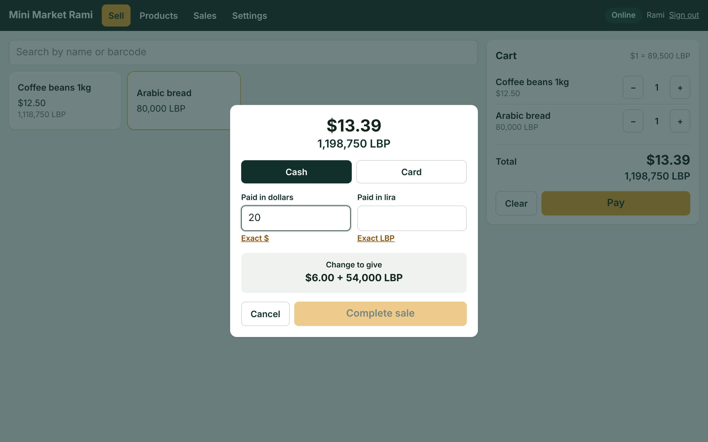
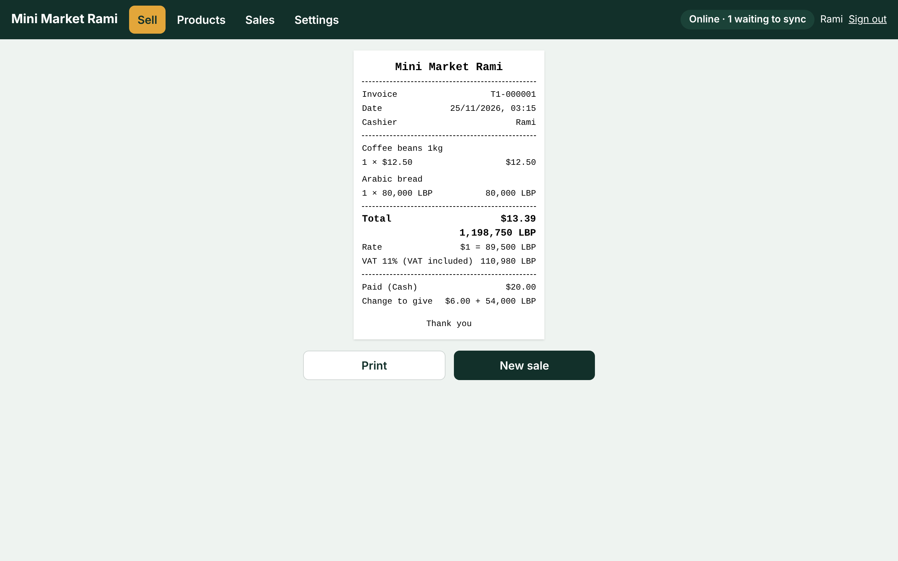
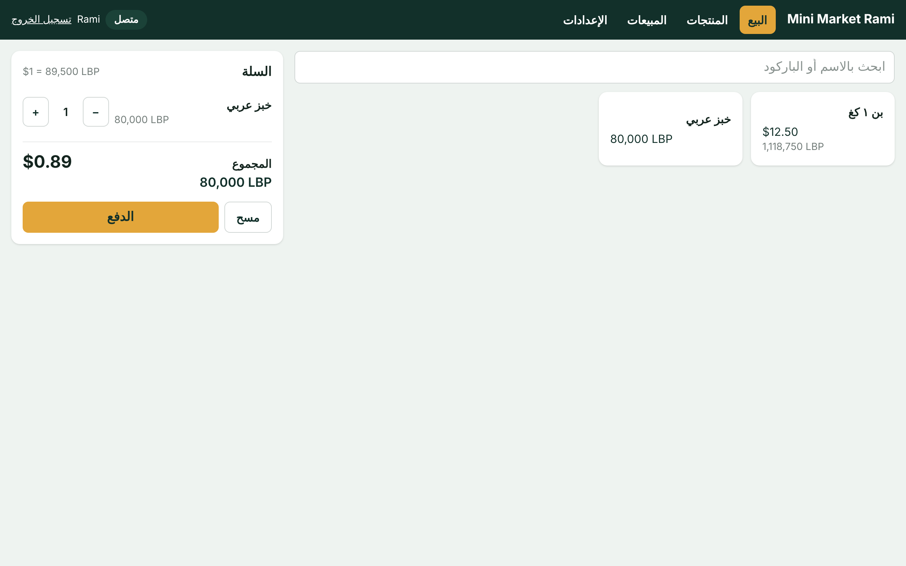

# lebanon-POS

A point-of-sale system for Lebanese shops, cafés and restaurants. It sells in dollars and lira
at the same till and keeps working through power and internet cuts.

| Pay in dollars, lira or both | Receipt with the rate and both totals | Arabic, right to left |
|---|---|---|
|  |  |  |

## What works today

- **Shops and staff:** create a shop, sign in, and add staff as owner, manager or cashier.
- **Exchange rate:** a manager sets the day's rate; every sale stores the rate it used.
- **VAT:** 11% by default, stored with a start date so a change in the law is a setting.
  Each product is standard, exempt or zero-rated.
- **Products:** name in English and Arabic, barcode, price in USD or LBP.
- **Selling:** search or scan, pay in USD, LBP or both, with change suggested as whole
  dollars plus rounded lira. Receipts are sized for 80 mm printers.
- **Offline:** sales are saved on the device first and sent when the connection returns.
  A sale sent twice is stored once.
- **Control:** only a manager or owner can cancel a sale, and must give a reason. Rate
  changes, price changes and cancelled sales are written to an audit log. Sales whose
  numbers do not add up are kept and flagged for review.
- **Daily report:** sales, VAT in lira, and the cash expected in the drawer per currency.

## Layout

| Folder | What it is |
|---|---|
| `backend/` | ASP.NET Core API on .NET 10 with EF Core and PostgreSQL |
| `frontend/` | React + TypeScript web app (Vite, Tailwind), installable as a PWA |
| `reports/`, `research_notes/` | Market research and planning documents |

Money is stored as whole numbers: USD in cents and LBP in pounds. The sale and change
calculations exist twice, in `backend/src/LebanonPos.Domain/Money` and
`frontend/src/lib/money.ts`, with the same test cases on both sides so offline totals
match the server.

## Run it locally

You need the .NET 10 SDK, Node 22 and PostgreSQL 16.

Create a database user (once):

```bash
psql -U postgres -c "create user lebpos with password 'lebpos' createdb"
```

Start the API on port 5080. In development it creates and migrates the database itself:

```bash
cd backend && ASPNETCORE_ENVIRONMENT=Development ASPNETCORE_URLS=http://localhost:5080 dotnet run --project src/LebanonPos.Api --no-launch-profile
```

Start the web app, then open http://localhost:5173:

```bash
cd frontend && npm install && npm run dev
```

## Tests

Backend tests need the local PostgreSQL user above; each run uses a throwaway database:

```bash
cd backend && dotnet test
```

```bash
cd frontend && npm test
```

## Production settings

The API reads these from the environment. Never commit real values.

| Setting | Meaning |
|---|---|
| `ConnectionStrings__Default` | PostgreSQL connection string (Supabase: use the connection string from the project's database settings) |
| `Jwt__Key` | Secret signing key, at least 32 characters |
| `Cors__Origins__0` | Address of the web app |
| `Database__MigrateOnStartup` | `true` to apply database migrations when the API starts |

Supabase is used as a plain PostgreSQL database, so moving to another PostgreSQL host
only means changing the connection string.
